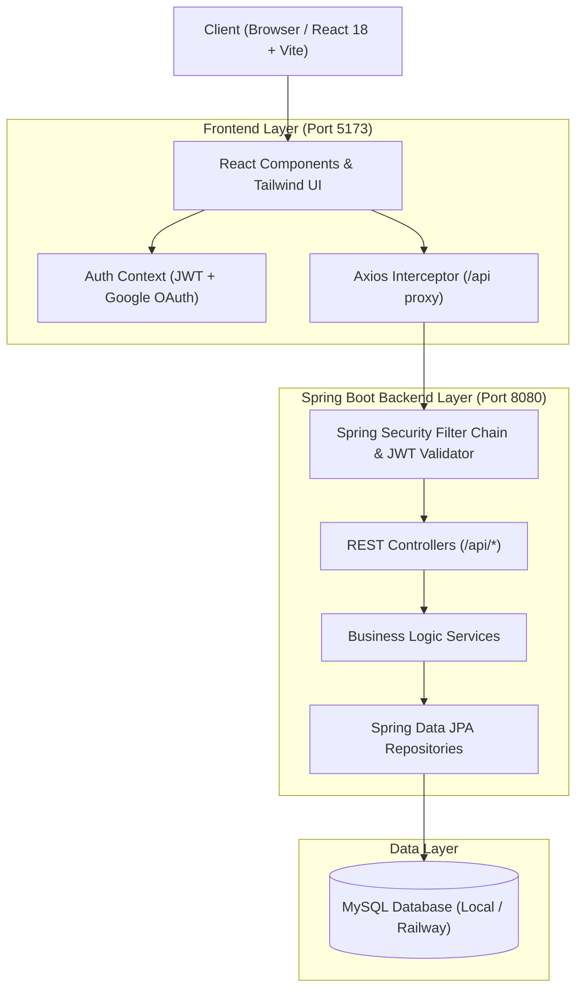

# 🎓 PlacementPrep — Full-Stack Placement Preparation Platform

> A production-ready, full-stack web application designed for engineering students preparing for top tier campus placements and technical interviews across **Quantitative & Logical Aptitude**, **CS Fundamentals**, and **Data Structures & Algorithms (DSA)**.

---

## 📑 Table of Contents

- [Overview](#-overview)
- [Key Features](#-key-features)
  - [Student Experience](#1-student-experience)
  - [Admin Experience](#2-admin-portal)
- [Technology Stack](#-technology-stack)
- [System Architecture](#-system-architecture)
- [Directory Structure](#-directory-structure)
- [Quick Start Guide](#-quick-start-guide)
  - [Prerequisites](#prerequisites)
  - [1. Database Configuration (Local MySQL or Railway)](#1-database-configuration)
  - [2. Backend Setup (Spring Boot)](#2-backend-setup-spring-boot)
  - [3. Frontend Setup (React + Vite)](#3-frontend-setup-react--vite)
- [Configuration & Environment Variables](#-configuration--environment-variables)
- [Google OAuth 2.0 Integration](#-google-oauth-20-integration)
- [Pre-Seeded Demo Credentials](#-pre-seeded-demo-credentials)
- [REST API Reference](#-rest-api-reference)
- [Database Schema & Auto-Seeding](#-database-schema--auto-seeding)
- [Production Build & Deployment](#-production-build--deployment)
- [Contributing & License](#-license)

---

## 🌟 Overview

**PlacementPrep** is an all-in-one preparation ecosystem that combines timed mock assessments, curriculum-aligned topic tests, interactive DSA problem tracking, real-time analytics, and an administrative management suite.

---

## ✨ Key Features

### 1. Student Experience

- **🔐 Secure Authentication:**
  - Standard Email + Password registration & login with stateless JWT tokens.
  - **One-Tap Sign in with Google** via Google Identity Services (automatically creates student accounts on first login).
  - Role-based authorization (`ROLE_STUDENT`, `ROLE_ADMIN`).
  - Profile tracking with College, Branch, and Graduation Year.

- **📊 Smart Dashboard & Analytics:**
  - Real-time placement metrics: total questions solved, tests attempted, average accuracy, and daily login streak.
  - Overall syllabus completion progress bars across all sections.
  - Automated detection of **Strong Areas** (Accuracy $\ge$ 75%) and **Weak Areas** (Accuracy $<$ 50%) with personalized recommendations.

- **🧮 Section 1: Aptitude (Chapter-Wise):**
  - Quantitative Aptitude (Percentages, Profit & Loss, Time & Work, Ratio & Proportion, Number Systems, Permutations & Combinations, Probability, etc.).
  - Logical Reasoning & Verbal Ability.
  - Questions stratified into **Easy**, **Medium**, and **Hard** tiers.
  - **5-Minute Chapter Test Engine**: Automatically selects 10 balanced questions (4 Easy, 4 Medium, 2 Hard) with live countdown timer and auto-submission on expiration.

- **💻 Section 2: CS Fundamentals:**
  - Core subject tests: **Operating Systems (OS)**, **Database Management Systems (DBMS)**, **Computer Networks (CN)**, and **Object-Oriented Programming (OOP)**.
  - In-depth, step-by-step conceptual explanations for every question.

- **🌲 Section 3: Curated DSA Tracker:**
  - High-frequency placement problems categorized across 19 standard topics (Arrays, Strings, Linked Lists, Trees, Graphs, Dynamic Programming, Greedy, etc.).
  - Interactive status toggle (`NOT_STARTED`, `ATTEMPTED`, `SOLVED`) with direct external links to LeetCode and GeeksforGeeks.
  - **Sticky "Solved" Protection:** Once a problem is marked Solved, it cannot be accidentally downgraded without an explicit *Undo → Confirm* modal (enforced on both frontend and backend).

- **🎲 Custom Random Test Generator:**
  - Create customized mock tests by selecting Target Section, Difficulty (Easy / Medium / Hard / Mixed), and Question Count (10, 20, or 30 questions).

- **📝 Interactive Test Taking Environment:**
  - Real-time countdown timer with auto-submit.
  - Question palette with status indicators (Answered, Unanswered, Marked for Review).
  - Clear answer and review options before final submission.

- **🏆 Instant Results & Explanations Engine:**
  - Detailed score, percentage accuracy, and time taken.
  - Filterable question review: All, Correct, Incorrect, and Unattempted.
  - Step-by-step mathematical formulas, code snippets, and explanations.

---

### 2. Admin Portal

- **📈 Platform Telemetry Dashboard:**
  - Live statistics: total registered students, total tests completed, question bank volume, and question distribution by subject/difficulty.
- **👥 Student Directory:**
  - Searchable, paginated student management with view-only student profile and historical test breakdown.
- **📚 Question Bank Management:**
  - Full CRUD capabilities: create, update, search, filter, and delete questions.
- **📤 Two-Step Bulk Upload:**
  - Upload question spreadsheets via CSV or Excel (`.xlsx`, `.xls`).
  - **Interactive Preview & Validation**: Scans uploaded files, flags errors row-by-row, and provides a transactional commit button.
- **🗂️ Curriculum & Subject Manager:**
  - Add, edit, and organize Sections, Subjects, and Chapters dynamically.
- **🧩 DSA Problem Management:**
  - Create, update, categorize, and link new DSA problems to LeetCode/GFG.

---

## 🛠️ Technology Stack

| Layer | Technologies |
|---|---|
| **Frontend** | React 18, Vite 6, Tailwind CSS 3, Lucide Icons, Canvas-Confetti, Axios, React Router 6 |
| **Backend** | Java 21, Spring Boot 3.4.x (Web, Data JPA, Security), JJWT, Lombok, Jakarta Validation, Springdoc OpenAPI |
| **Database** | MySQL 8.x (Local or Railway / Cloud MySQL) |
| **Authentication** | JWT (JSON Web Tokens) + Google Identity Services (OAuth 2.0 ID Token verification) |
| **Documentation** | Swagger / OpenAPI 3.1 (`/swagger-ui.html` & `/api-docs`) |
| **Build Tools** | Maven (Backend) & npm / Vite (Frontend) |

---

## 🏗️ System Architecture



---

## 📁 Directory Structure

```text
├── backend/
│   ├── src/main/java/com/placementprep/
│   │   ├── config/              # Security, CORS, Swagger, Seeders (Curriculum & Initializer)
│   │   ├── controller/          # Auth, Admin, Content, Test, DSA, Dashboard, Progress, Health
│   │   ├── dto/                 # Request & Response Data Transfer Objects
│   │   ├── entity/              # JPA Entities (User, Question, Subject, Chapter, TestAttempt, etc.)
│   │   ├── exception/           # Global Exception Handlers & Custom Exceptions
│   │   ├── repository/         # Spring Data JPA Repositories
│   │   ├── security/            # JWT Token Provider, Auth Filters, UserDetails Service
│   │   └── service/             # Business Logic & Service Implementations
│   ├── src/main/resources/
│   │   └── application.yml      # App configuration, DataSource, JPA, JWT, Google Client ID
│   └── pom.xml                  # Maven dependencies & build definitions
│
├── frontend/
│   ├── public/                  # Static assets
│   ├── src/
│   │   ├── api/                 # Axios HTTP client configuration & endpoint helpers
│   │   ├── components/          # Reusable UI components, Modals, Navbar, Brand Intro
│   │   ├── context/             # AuthContext & global state providers
│   │   ├── hooks/               # Custom React hooks
│   │   ├── pages/               # Student pages (Dashboard, Aptitude, CS, DSA, Test, Results)
│   │   │   └── admin/           # Admin pages (Dashboard, Students, Questions, Curriculum, DSA)
│   │   ├── routes/              # Protected & Role-based route definitions
│   │   ├── App.jsx              # Application root
│   │   └── index.css            # Tailwind & custom animation styles
│   ├── package.json             # Frontend dependencies & npm scripts
│   ├── vite.config.js           # Vite dev server & proxy settings
│   └── tailwind.config.js       # Tailwind CSS configuration
└── README.md
```

---

## 🚀 Quick Start Guide

### Prerequisites

- **Java Development Kit (JDK):** Version 21
- **Apache Maven:** Version 3.9+
- **Node.js:** Version 18+ and `npm`
- **Database:** MySQL Server 8.0+ (Local or Cloud instance e.g., Railway / PlanetScale)

---

### 1. Database Configuration

#### Option A: Local MySQL
1. Ensure MySQL is running on `localhost:3306`.
2. Default username is `root`.
3. Set your root password in `backend/src/main/resources/application.yml` or export the environment variable:
   ```bash
   export DATABASE_PASSWORD="your_mysql_password"
   ```

#### Option B: Railway / Cloud MySQL
1. Create a MySQL database instance in [Railway](https://railway.app/).
2. Copy the JDBC connection details and configure them in `backend/src/main/resources/application.yml` or set environment variables:
   ```bash
   # Windows PowerShell
   $env:DATABASE_URL="jdbc:mysql://<host>:<port>/<database>?createDatabaseIfNotExist=true&allowPublicKeyRetrieval=true&useSSL=false&serverTimezone=UTC"
   $env:DATABASE_USERNAME="root"
   $env:DATABASE_PASSWORD="<railway_password>"

   # Linux / macOS
   export DATABASE_URL="jdbc:mysql://<host>:<port>/<database>?createDatabaseIfNotExist=true&allowPublicKeyRetrieval=true&useSSL=false&serverTimezone=UTC"
   export DATABASE_USERNAME="root"
   export DATABASE_PASSWORD="<railway_password>"
   ```

> 💡 **Automatic Table Creation**: `spring.jpa.hibernate.ddl-auto` is set to `update`. The database and all tables are created and seeded automatically on first startup!

---

### 2. Backend Setup (Spring Boot)

```bash
# Navigate to backend directory
cd backend

# Run the Spring Boot application
mvn spring-boot:run
```

- **Backend API URL:** `http://localhost:8080`
- **Interactive Swagger UI:** `http://localhost:8080/swagger-ui.html`
- **OpenAPI JSON Spec:** `http://localhost:8080/api-docs`
- **Health Check:** `http://localhost:8080/api/health`

---

### 3. Frontend Setup (React + Vite)

```bash
# Open a new terminal and navigate to frontend directory
cd frontend

# Install dependencies
npm install

# Start the Vite development server
npm run dev
# (On Windows PowerShell if execution policy blocks npm, use: npm.cmd run dev)
```

- **Frontend Application URL:** `http://localhost:5173`
- The Vite dev server is pre-configured to proxy `/api` requests to `http://localhost:8080`.

---

## ⚙️ Configuration & Environment Variables

### Backend (`application.yml` / System Env)

| Variable | Description | Default / Example |
|---|---|---|
| `DATABASE_URL` | JDBC Connection URL | `jdbc:mysql://localhost:3306/placement_prep?...` |
| `DATABASE_USERNAME` | Database username | `root` |
| `DATABASE_PASSWORD` | Database password | `Adi123*#` |
| `JWT_SECRET` | 256-bit Hex/Base64 secret for JWT signing | `404E6352...` |
| `GOOGLE_CLIENT_ID` | Google OAuth 2.0 Web Client ID | `your-id.apps.googleusercontent.com` |

### Frontend (`frontend/.env`)

| Variable | Description | Default / Example |
|---|---|---|
| `VITE_GOOGLE_CLIENT_ID` | Google OAuth 2.0 Web Client ID | `your-id.apps.googleusercontent.com` |
| `VITE_API_BASE_URL` | Base URL for API (for production builds) | `http://localhost:8080/api` |

---

## 🔑 Pre-Seeded Demo Credentials

Upon initial launch, database seeders (`DataInitializer` and `CurriculumSeeder`) automatically populate sample accounts and curriculum questions:

| Role | Email | Password | Access Rights |
|---|---|---|---|
| **Student** | `student@placementprep.com` | `student123` | Student Dashboard, Aptitude Tests, CS Tests, DSA Tracker, History |
| **Admin** | `admin@placementprep.com` | `admin123` | Admin Dashboard, Question Bank CRUD, Bulk Upload, Student Management |

*(Quick 1-click credential fill buttons are also available on the Login page).*

---

## 🌐 Google OAuth 2.0 Integration

To enable the **"Continue with Google"** one-tap button:

1. Open [Google Cloud Console](https://console.cloud.google.com/) $\rightarrow$ **APIs & Services $\rightarrow$ Credentials**.
2. Create **OAuth 2.0 Client ID** (Application Type: **Web application**).
3. Add Authorized JavaScript Origins:
   - `http://localhost:5173` (Local Vite Dev Server)
   - `http://localhost:8080` (Local Spring Boot Server)
   - Your production domains (if deployed).
4. Paste the Client ID into:
   - `frontend/.env` $\rightarrow$ `VITE_GOOGLE_CLIENT_ID`
   - `backend/src/main/resources/application.yml` or `GOOGLE_CLIENT_ID` environment variable.

---

## 📡 REST API Reference

### 🔐 Authentication (`/api/auth`)
| Method | Endpoint | Description | Auth Required |
|---|---|---|---|
| `POST` | `/api/auth/register` | Register new student profile | No |
| `POST` | `/api/auth/login` | Login with email/password (returns JWT) | No |
| `POST` | `/api/auth/google` | Authenticate with Google ID token | No |
| `GET` | `/api/auth/me` | Fetch authenticated user profile | Yes (`Bearer Token`) |

### 📚 Curriculum & Content (`/api`)
| Method | Endpoint | Description | Auth Required |
|---|---|---|---|
| `GET` | `/api/sections` | List all sections (Aptitude, CS, DSA) | Yes |
| `GET` | `/api/sections/{code}` | Get section details and subjects | Yes |
| `GET` | `/api/subjects/section/{sectionCode}` | Get subjects by section | Yes |
| `GET` | `/api/chapters/subject/{subjectId}` | Get chapters for a subject | Yes |
| `GET` | `/api/chapters/{chapterId}` | Get chapter detail & question counts | Yes |

### ⏱️ Test Engine (`/api/tests`)
| Method | Endpoint | Description | Auth Required |
|---|---|---|---|
| `POST` | `/api/tests/start` | Start 5-min balanced chapter test (4E, 4M, 2H) | Yes |
| `POST` | `/api/tests/random` | Start randomized custom test | Yes |
| `POST` | `/api/tests/{testId}/submit` | Submit answers, calculate score & solutions | Yes |
| `GET` | `/api/tests/{testId}/result` | View detailed test results and explanations | Yes |
| `GET` | `/api/tests/history` | Get student test attempt history | Yes |

### 📊 Dashboard & Progress (`/api`)
| Method | Endpoint | Description | Auth Required |
|---|---|---|---|
| `GET` | `/api/dashboard` | Student metrics, streaks, strong/weak areas | Yes |
| `GET` | `/api/progress/overall` | Overall syllabus mastery breakdown | Yes |

### 🧩 DSA Tracker (`/api/dsa`)
| Method | Endpoint | Description | Auth Required |
|---|---|---|---|
| `GET` | `/api/dsa/topics` | Get list of distinct DSA topics | Yes |
| `GET` | `/api/dsa/problems` | List problems with user status and topic filter | Yes |
| `PUT` | `/api/dsa/problems/{problemId}/status` | Update problem status (`NOT_STARTED`, `ATTEMPTED`, `SOLVED`) | Yes |

### 🛡️ Admin Management (`/api/admin` - Requires `ROLE_ADMIN`)
| Method | Endpoint | Description |
|---|---|---|
| `GET` | `/api/admin/dashboard` | High-level metrics, counts, and recent registrations |
| `GET` | `/api/admin/students` | Search and list registered students (paginated) |
| `GET` | `/api/admin/students/{id}` | View detailed student test history & profile |
| `GET` | `/api/admin/questions/statistics` | Question distribution per section and chapter |
| `GET` | `/api/admin/questions` | List questions with search & difficulty filters |
| `POST` | `/api/admin/questions` | Create a new question |
| `PUT` | `/api/admin/questions/{id}` | Update existing question |
| `DELETE`| `/api/admin/questions/{id}` | Delete a question |
| `POST` | `/api/admin/questions/bulk-upload` | Validate and preview CSV/Excel question file |
| `POST` | `/api/admin/questions/bulk-commit` | Commit validated question batch to database |
| `POST` | `/api/admin/subjects` | Create subject |
| `PUT` | `/api/admin/subjects/{id}` | Update subject |
| `POST` | `/api/admin/chapters` | Create chapter |
| `PUT` | `/api/admin/chapters/{id}` | Update chapter |
| `GET` | `/api/admin/dsa-problems` | List DSA problems |
| `POST` | `/api/admin/dsa-problems` | Create DSA problem |
| `PUT` | `/api/admin/dsa-problems/{id}` | Update DSA problem |
| `DELETE`| `/api/admin/dsa-problems/{id}` | Delete DSA problem |

---

## 📦 Production Build & Deployment

### Build Backend
```bash
cd backend
mvn clean package -DskipTests
# The executable JAR will be located at: target/placementprep-backend-1.0.0.jar
java -jar target/placementprep-backend-1.0.0.jar
```

### Build Frontend
```bash
cd frontend
npm run build
# The optimized production files will be output to: frontend/dist/
```

---

## 📄 License

This project is licensed under the **MIT License**. Feel free to use, modify, and distribute for educational and commercial purposes.
