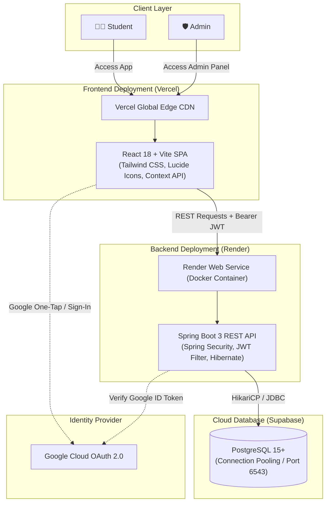

# 🎓 PlacementPrep Platform

[](https://www.oracle.com/java/)
[](https://spring.io/projects/spring-boot)
[](https://react.dev/)
[](https://vitejs.dev/)
[](https://tailwindcss.com/)
[](https://supabase.com/)
[](https://apticode-rho.vercel.app/login)
[](https://render.com/)
[](https://opensource.org/licenses/MIT)

> 🚀 **Live Demo**: **[https://apticode-rho.vercel.app/login](https://apticode-rho.vercel.app/login)**  
> Try the live application directly in your browser with the demo credentials below!

A modern, production-grade full-stack platform designed to help engineering students prepare effectively for campus placements, technical assessments, and software engineering interviews. 

The platform features timed topic-based tests, comprehensive CS fundamentals learning paths, LeetCode-style DSA problem tracking, progress analytics, and a powerful administrative control panel equipped with bulk Excel question imports and dynamic curriculum management.

---

## 🌐 Live Deployments & Architecture

The application is architected as a decoupled, modern cloud-native system:

| Layer | Hosting Provider | Live URL / Endpoint | Description |
|---|---|---|---|
| **Frontend (Live Demo)** | [Vercel](https://vercel.com) | [apticode-rho.vercel.app/login](https://apticode-rho.vercel.app/login) | Production React 18 SPA with global edge delivery |
| **Backend REST API** | [Render](https://render.com) | `https://placementprep-backend.onrender.com` | Dockerized Spring Boot 3 service with automatic zero-downtime deploys |
| **Database** | [Supabase](https://supabase.com) | `aws-0-[region].pooler.supabase.com:6543` | Managed PostgreSQL with connection pooling & automated failover |
| **API Documentation** | Swagger / OpenAPI 3 | `https://placementprep-backend.onrender.com/swagger-ui.html` | Interactive REST API testing interface |



---

## ⚡ Core Features

### 👨‍🎓 Student Ecosystem
- **Flexible Authentication**: Sign up with email and password or perform 1-click login using **Google OAuth 2.0**.
- **Interactive Student Dashboard**:
  - Live counts of completed tests, total questions answered, and overall average score.
  - Active study streak counter to encourage consistent daily practice.
  - Quick launcher for recent test activities and recommended chapters.
- **Aptitude & Technical Assessments**:
  - **Timed Tests**: 5-minute countdown timer with auto-submit safeguard upon expiration.
  - **Weighted Difficulty**: Automatically pulls 10 balanced questions (4 Easy, 4 Medium, 2 Hard) per chapter.
  - **Custom Practice Mode**: Filter randomized tests by Section, Difficulty, and Question Count.
  - **Question Palette**: Interactive question grid with status flags (Answered vs Unanswered).
- **In-Depth Results & Answer Key**:
  - Immediate score tally and percentage breakdown.
  - Side-by-side review showing student's chosen option, the verified correct option, and comprehensive step-by-step explanations.
- **Historical Records**: Paginated log of all past test attempts with scores, completion status, and review shortcuts.
- **Core CS Fundamentals Modules**: Chapter-organized study guides covering foundational concepts:
  - Operating Systems (OS)
  - Database Management Systems (DBMS)
  - Computer Networks (CN)
  - Object-Oriented Programming (OOPs)
- **DSA Problem Tracker**:
  - Curated LeetCode-style problem list sorted by topic (Arrays, Strings, Linked Lists, Trees, Graphs, DP).
  - One-click links directly to external problem statements.
  - Multi-state progress toggling (`NOT_STARTED`, `ATTEMPTED`, `SOLVED`).
- **Progress Analytics**: Visual mastery indicators tracking competencies across subjects and difficulty tiers.
- **Dark & Light Mode**: Built-in theme toggle with local storage persistence and reduced-motion support.

---

### 🛡️ Administrative Management Suite (`ROLE_ADMIN`)
- **Admin Dashboard**: System metrics including registered student counts, question bank size, total assessments taken, and subject coverage.
- **Student Management Directory**:
  - Searchable, paginated student roster with registration timestamps and college affiliations.
  - Read-only student inspection detailing specific student test records and average accuracy.
- **Question Bank Control**:
  - Full CRUD capabilities: create, preview, edit, and delete questions with multi-choice options and explanations.
  - **Bulk Excel Import (`.xlsx`)**: Upload hundreds of questions at once with automated schema validation and pre-commit preview table.
  - Downloadable Excel template ensuring zero formatting errors.
- **Curriculum Hierarchy Manager**: Manage *Sections (Aptitude, CS Fundamentals) ➔ Subjects ➔ Chapters*.
- **DSA Problem Bank**: Add, modify, or tag new algorithmic problems.

---

## 🛠️ Technology Stack

| Domain | Technology | Details |
|---|---|---|
| **Frontend Framework** | React 18.3 | Modern functional components with Hooks and Context API |
| **Frontend Tooling** | Vite 6.1 | Ultra-fast HMR and optimized production bundling |
| **Styling & Icons** | Tailwind CSS 3.4 | Utility-first CSS, dark mode support, and Lucide React icons |
| **Client Routing** | React Router DOM 6.29 | Client-side routing with role-guarded routes (`StudentRoute`, `AdminRoute`) |
| **HTTP Client** | Axios 1.7 | Interceptors for automated JWT injection and 401 token handling |
| **Backend Framework** | Spring Boot 3.4.2 | Enterprise Java REST API framework running on Java 21 |
| **Security & Auth** | Spring Security + JJWT 0.12 | Stateless token-based security, BCrypt hashing, Google OAuth token verification |
| **Persistence / ORM** | Spring Data JPA / Hibernate 6 | Automated DDL migrations and type-safe query repositories |
| **Data Processing** | Apache POI 5.2.5 | Excel spreadsheet ingestion and parsing for bulk question bank imports |
| **Database** | PostgreSQL | Hosted on **Supabase** (with connection pooling) |
| **API Documentation** | SpringDoc OpenAPI 2.8 | Interactive Swagger UI available at `/swagger-ui.html` |
| **Containerization** | Docker | Multi-stage Alpine container (`temurin:21-jre-alpine`) |

---

## 🗄️ Database Schema & Entities

The platform leverages JPA entities with automated schema evolution (`ddl-auto: update`).

| Entity | Purpose | Key Columns |
|---|---|---|
| `users` | Students & Administrators | `id`, `name`, `email`, `password`, `role` (`ROLE_STUDENT`, `ROLE_ADMIN`), `college`, `branch`, `auth_provider` |
| `sections` | Top-level domains | `id`, `name` (e.g., Aptitude, CS Fundamentals), `code`, `icon`, `description` |
| `subjects` | Subjects under sections | `id`, `name` (e.g., Quantitative Aptitude, OS, DBMS), `section_id` |
| `chapters` | Chapters under subjects | `id`, `title`, `description`, `subject_id` |
| `questions` | MCQ items | `id`, `question_text`, `options` (JSON array), `correct_answer`, `explanation`, `difficulty`, `chapter_id` |
| `test_attempts` | Test sessions | `id`, `user_id`, `chapter_id`, `score`, `total_questions`, `status`, `started_at`, `completed_at` |
| `test_answers` | Question choices in a test | `id`, `test_attempt_id`, `question_id`, `selected_answer`, `is_correct` |
| `dsa_problems` | Problem repository | `id`, `title`, `topic`, `difficulty`, `leetcode_url` |
| `user_dsa_progress` | Student problem status | `id`, `user_id`, `problem_id`, `status` (`NOT_STARTED`, `ATTEMPTED`, `SOLVED`) |

---

## 🔑 Default Seeded Credentials

When connecting to an empty database, `DataInitializer` and `CurriculumSeeder` automatically populate default admin and student users, sample curriculum subjects, questions, and DSA problems:

| Account Type | Email | Password | Accessible Features |
|---|---|---|---|
| **Administrator** | `admin@placementprep.com` | `admin123` | Admin Dashboard, Student Directory, Question Bank, Curriculum Editor |
| **Student (Demo)** | `student@placementprep.com` | `student123` | Student Dashboard, Timed Tests, CS Modules, DSA Tracker, Analytics |

---

## 🚀 Deployment Guide

This project is tailored for frictionless deployment with **Vercel** (Frontend), **Render** (Backend), and **Supabase** (PostgreSQL Database).

### 1. Database Setup ➔ Supabase

1. Navigate to [Supabase](https://supabase.com) and create a new project.
2. Under **Project Settings** ➔ **Database**, find the **Connection string** section.
3. Select the **JDBC** or **URI** tab.
   - **Transaction / Session Pooler URL (Recommended for Render)**:
     ```
     jdbc:postgresql://aws-0-[REGION].pooler.supabase.com:6543/postgres?sslmode=require
     ```
   - **Direct Connection URL**:
     ```
     jdbc:postgresql://db.[PROJECT_REF].supabase.co:5432/postgres?sslmode=require
     ```
4. Note your database password and username (`postgres` or `postgres.[PROJECT_REF]`).
5. On the first startup of your Spring Boot backend, Hibernate will create all required tables automatically.

---

### 2. Backend Deployment ➔ Render

You can deploy the Spring Boot backend on Render using the included multi-stage `Dockerfile`:

1. Sign in to [Render](https://render.com) and click **New +** ➔ **Web Service**.
2. Connect your GitHub repository: `adityahikke/Placement-Prep-Platform`.
3. Fill in the service configuration:
   - **Name**: `placementprep-backend`
   - **Region**: Select the region closest to your Supabase instance.
   - **Environment**: `Docker`
   - **Dockerfile Path**: `./Dockerfile`
   - **Docker Context**: `.`
4. In the **Environment Variables** section, add:

| Environment Variable | Value / Format | Explanation |
|---|---|---|
| `SPRING_DATASOURCE_URL` | `jdbc:postgresql://aws-0-xx.pooler.supabase.com:6543/postgres?sslmode=require` | Supabase JDBC URL |
| `SPRING_DATASOURCE_USERNAME` | `postgres.your_supabase_ref` | Supabase DB username |
| `SPRING_DATASOURCE_PASSWORD` | `YourSupabasePassword` | Supabase DB password |
| `JWT_SECRET` | `404E635266556A586E3272357538782F413F4428472B4B6250645367566B5970` | 64+ char secret key |
| `GOOGLE_CLIENT_ID` | `your-google-oauth-client-id.apps.googleusercontent.com` | Optional: For Google Sign-in |
| `PORT` | `8080` | Internal application port |

5. Under **Advanced**, configure the Health Check Path:
   - **Health Check Path**: `/api/health`
6. Click **Deploy Web Service**. Once deployed, Render will provide your public backend URL (e.g., `https://placementprep-backend.onrender.com`).

> **Tip for Render Free Tier**: The `Dockerfile` includes JVM tuning flags (`-Xms256m -Xmx384m -XX:+UseG1GC`) to ensure smooth execution within the 512MB RAM free tier limit.

---

### 3. Frontend Deployment ➔ Vercel

1. Sign in to [Vercel](https://vercel.com) and click **Add New...** ➔ **Project**.
2. Import the `Placement-Prep-Platform` repository.
3. Configure the project settings:
   - **Framework Preset**: `Vite`
   - **Root Directory**: `frontend`
   - **Build Command**: `npm run build`
   - **Output Directory**: `dist`
4. Add the following **Environment Variables**:

| Variable | Example Value | Description |
|---|---|---|
| `VITE_API_BASE_URL` | `https://placementprep-backend.onrender.com` | URL of your deployed Render backend (omit trailing slash) |
| `VITE_GOOGLE_CLIENT_ID` | `your-client-id.apps.googleusercontent.com` | Google OAuth Web Client ID |

5. Click **Deploy**. Vercel will build and host your frontend globally with automatic routing rewrites (`vercel.json` and `public/_redirects`).  
   - **Production URL**: [https://apticode-rho.vercel.app/login](https://apticode-rho.vercel.app/login)

---

## 💻 Local Development Setup

### Prerequisites
- **JDK 21** installed and configured in `PATH`
- **Maven 3.9+**
- **Node.js 18+** and **npm**
- **PostgreSQL** installed locally OR a free Supabase cloud instance

### 1. Clone the Repository
```bash
git clone https://github.com/adityahikke/Placement-Prep-Platform.git
cd Placement-Prep-Platform
```

### 2. Backend Setup
Set environment variables or edit `backend/src/main/resources/application.yml`:

```bash
cd backend

# On Linux/macOS:
export SPRING_DATASOURCE_URL="jdbc:postgresql://localhost:5432/placementprep"
export SPRING_DATASOURCE_USERNAME="postgres"
export SPRING_DATASOURCE_PASSWORD="your_password"
export JWT_SECRET="404E635266556A586E3272357538782F413F4428472B4B6250645367566B5970"

# On Windows PowerShell:
$env:SPRING_DATASOURCE_URL="jdbc:postgresql://localhost:5432/placementprep"
$env:SPRING_DATASOURCE_USERNAME="postgres"
$env:SPRING_DATASOURCE_PASSWORD="your_password"
$env:JWT_SECRET="404E635266556A586E3272357538782F413F4428472B4B6250645367566B5970"

# Run Spring Boot application
mvn spring-boot:run
```

- Backend server: `http://localhost:8080`
- Swagger UI docs: `http://localhost:8080/swagger-ui.html`
- Health check: `http://localhost:8080/api/health`

### 3. Frontend Setup
In a new terminal:

```bash
cd frontend

# Install packages
npm install

# Start Vite dev server
npm run dev
```

- Open your browser at: `http://localhost:5173`

---

## 📡 REST API Reference

All protected endpoints require an `Authorization: Bearer <JWT>` header.

### 🔐 Authentication (`/api/auth`)
| Method | Endpoint | Access | Description |
|---|---|---|---|
| `POST` | `/api/auth/register` | Public | Register a new student account |
| `POST` | `/api/auth/login` | Public | Authenticate student/admin and receive JWT |
| `POST` | `/api/auth/google` | Public | Sign in / register via Google ID token |
| `GET` | `/api/auth/me` | Authenticated | Fetch active user profile and role |

### 📚 Content & Curriculum (`/api`)
| Method | Endpoint | Access | Description |
|---|---|---|---|
| `GET` | `/api/sections` | Public | List all curriculum sections (Aptitude, CS, DSA) |
| `GET` | `/api/sections/{code}` | Public | Get section details by code (`APTITUDE`, etc.) |
| `GET` | `/api/subjects/section/{code}` | Public | List subjects associated with a section |
| `GET` | `/api/chapters/subject/{id}` | Public | List chapters under a subject |
| `GET` | `/api/chapters/{id}` | Public | Get chapter statistics and question counts |

### 📝 Test Engine (`/api/tests`)
| Method | Endpoint | Access | Description |
|---|---|---|---|
| `POST` | `/api/tests/start` | Student / Admin | Start a 5-minute timed test for a chapter |
| `POST` | `/api/tests/random` | Student / Admin | Start a customized practice test |
| `POST` | `/api/tests/{testId}/submit` | Student / Admin | Submit answers for scoring and review generation |
| `GET` | `/api/tests/{testId}/result` | Student / Admin | View detailed test results and explanations |
| `GET` | `/api/tests/history` | Student / Admin | List all completed test attempts for current user |

### 💻 DSA Tracker (`/api/dsa`)
| Method | Endpoint | Access | Description |
|---|---|---|---|
| `GET` | `/api/dsa/problems` | Authenticated | List problems with filters (topic, difficulty) + user status |
| `PUT` | `/api/dsa/problems/{id}/status` | Authenticated | Update status (`NOT_STARTED`, `ATTEMPTED`, `SOLVED`) |
| `GET` | `/api/dsa/topics` | Authenticated | List all distinct DSA topic categories |

### 📊 Dashboard & Analytics (`/api`)
| Method | Endpoint | Access | Description |
|---|---|---|---|
| `GET` | `/api/dashboard` | Authenticated | Get student stats, streak counter, and recent tests |
| `GET` | `/api/progress/overall` | Authenticated | Get chapter-wise mastery distribution |

### 🛡️ Admin Suite (`/api/admin` - Requires `ROLE_ADMIN`)
| Method | Endpoint | Description |
|---|---|---|
| `GET` | `/api/admin/dashboard` | Platform counts, question metrics, student growth |
| `GET` | `/api/admin/students` | Paginated and searchable student directory |
| `GET` | `/api/admin/students/{id}` | Detailed student profile and test record |
| `GET` | `/api/admin/students/{id}/tests` | All test attempts of a given student |
| `POST` | `/api/admin/questions` | Create a single question |
| `PUT` | `/api/admin/questions/{id}` | Update question text, options, or answer |
| `DELETE` | `/api/admin/questions/{id}` | Delete a question |
| `POST` | `/api/admin/questions/bulk-preview` | Upload and preview questions from `.xlsx` Excel file |
| `POST` | `/api/admin/questions/bulk-commit` | Commit validated bulk Excel questions |
| `GET` | `/api/admin/questions/bulk-template` | Download standard bulk question Excel template |
| `POST` | `/api/admin/subjects` | Create a subject |
| `POST` | `/api/admin/chapters` | Create a chapter |
| `POST` | `/api/admin/dsa` | Create a DSA problem |

---

## 🔒 Security Architecture

1. **Stateless JWT Tokens**:
   - Access tokens generated using HMAC-SHA256 with 24-hour expiration.
   - Extracted and verified on every incoming request by `AuthTokenFilter`.
2. **Password Cryptography**:
   - Industry-standard `BCryptPasswordEncoder` ensures zero plaintext passwords.
3. **Role-Based Access Control (RBAC)**:
   - Separate route guards in the frontend (`StudentRoute` vs `AdminRoute`).
   - Method security `@PreAuthorize("hasAuthority('ROLE_ADMIN')")` prevents student accounts from accessing admin endpoints.
4. **CORS Hardening**:
   - Configured in `CorsConfig.java` to support requests from Vercel frontends, passing credentials and exposing authorization headers.

---

## 📁 Repository Structure

```
Placement-Prep-Platform/
├── Dockerfile                      # Production multi-stage Docker build for Backend
├── README.md                       # Comprehensive Project Documentation
│
├── backend/                        # Spring Boot 3 Java Service
│   ├── pom.xml                     # Maven build definitions and dependencies
│   └── src/main/
│       ├── java/com/placementprep/
│       │   ├── config/             # Security, CORS, Swagger, Database Seeders
│       │   ├── controller/         # REST API Controllers
│       │   ├── dto/                # Request/Response Data Transfer Objects
│       │   ├── entity/             # JPA Entities (User, Question, Test, etc.)
│       │   ├── exception/          # Global Exception Handling & Error Responses
│       │   ├── repository/         # Spring Data JPA Repositories
│       │   ├── security/           # JWT Utilities and Authentication Filters
│       │   └── service/            # Business Logic & Test Assessment Engine
│       └── resources/
│           └── application.yml     # Spring Datasource, JPA, JWT, and Server Config
│
└── frontend/                       # React 18 + Vite Frontend Application
    ├── package.json                # NPM packages and build scripts
    ├── vite.config.js              # Vite configuration
    ├── tailwind.config.js          # Tailwind CSS styling and theme rules
    ├── vercel.json                 # Vercel SPA client rewrite routing
    ├── public/
    │   └── _redirects              # Netlify/Vercel static redirect rules
    └── src/
        ├── api/                    # Axios HTTP client and endpoints
        ├── components/             # Reusable UI components, Modals, Navbar, Layouts
        ├── context/                # AuthContext, ThemeContext, ToastContext
        ├── hooks/                  # Custom hooks (e.g. useTestTimer)
        ├── pages/                  # Student views (Dashboard, Tests, DSA, CS)
        │   └── admin/              # Admin views (QuestionBank, Students, Curriculum)
        └── routes/                 # Protected routes and navigation guards
```

---

## 🤝 Contributing

Contributions make the open-source community an amazing place to learn, inspire, and create. Any contributions you make are **greatly appreciated**.

1. Fork the Project
2. Create your Feature Branch (`git checkout -b feature/AmazingFeature`)
3. Commit your Changes (`git commit -m 'feat: Add AmazingFeature'`)
4. Push to the Branch (`git push origin feature/AmazingFeature`)
5. Open a Pull Request

---

## 📄 License

Distributed under the MIT License. See `LICENSE` for more information.

---

## 👨‍💻 Author

**Aditya Hikke**  
- GitHub: [@adityahikke](https://github.com/adityahikke)  
- LinkedIn: [Aditya Hikke](https://www.linkedin.com/in/adityahikke)

---

<p align="center">
  Built with ❤️ to empower every student to crack their dream campus placement.
</p>
